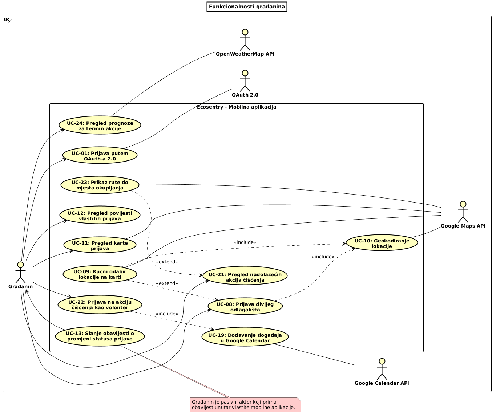
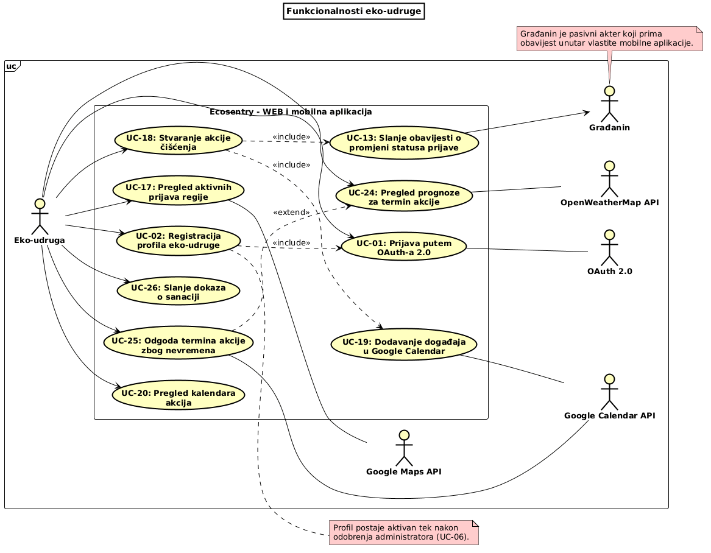
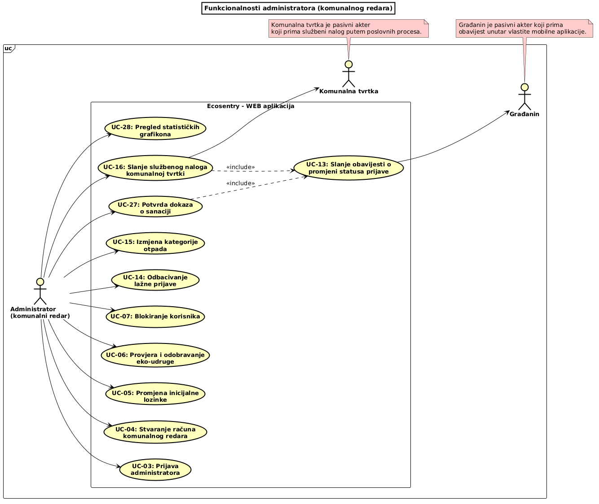

# 3. Obrasci uporabe

**Cilj:** Prikazati glavne interakcije između aktera aplikacije i sustava. Opišite kako akter ostvaruje cilj i što se događa kada važan korak ne uspije. Interakcije temeljite na odobrenim zahtjevima i ažurirajte ih kako se aplikacija razvija.

## 3.1 Dijagram obrazaca uporabe

_Slika 3.1.1 - Dijagram obrazaca uporabe: Funkcionalnosti građanina_

_Slika 3.1.2 - Dijagram obrazaca uporabe: Funkcionalnosti eko-udruge_

_Slika 3.1.3: Dijagram obrazaca uporabe - Funkcionalnosti administratora (komunalnog redara)_

**Napomena:** Sustav je prikazan uz pomoć 3 dijagrama jer su svi pokušaji spajanja više aktera u jedan dijagram rezultirali jako nečitljivim i nezgrapnim dijagramom. Zadatak je takav da građanin, eko-udruga i administrator imaju potpuno drukčiji skup obrazaca uporabe te je samim time teže provesti proces generalizacije. Jedino građanin i eko-udruga dijele mali broj obrazaca, ali i tada zbog samoga broja ostalih obrazaca dijagram funkcionalnosti građanina i eko-udruge bi bio nepregledan.

---

**Cilj:** Prikazati granicu sustava, relevantne aktere i njihove glavne ciljeve u **jednom čitljivom UML dijagramu obrazaca uporabe**. Dodajte drugi, usmjereni dijagram samo ako potpuni prikaz više ne može ostati čitljiv; treći dijagram zahtijeva zaseban razlog specifičan za projekt.

**Slika 3.1. Dijagram obrazaca uporabe sustava CrisisMap**

**PlantUML izvor:** [izvor](./puml/3-1-crisismap-system-UC.puml)

**Provjera dijagrama:** Prikažite prepoznate uloge koje **komuniciraju s aplikacijom**, a ne dionike koji s njom nemaju interakciju. Svaki glavni korisnički cilj mora imati pridruženog aktera; uključeni obrazac uporabe može se dosegnuti preko drugog obrasca uporabe bez vlastite izravne veze s akterom. `<<include>>` i `<<extend>>` koristite samo kada odnos odgovara stvarnom ponašanju.

<strong>Primjer odabira aktera i granica sustava</strong>

**Opis primjera — CrisisMap:**

Dijagram prikazuje **ogledni scenarij** s građaninom, posjetiteljem i organizacijom koja provjerava dostupne resurse. Organizaciju uključite kao aktera samo ako joj odobreni projekt stvarno omogućuje interakciju s aplikacijom. OAuth je izvan ovog primjera jer je riječ o implementacijski specifičnom načinu prijave i pripada zahtjevima samo ako je odobren.

**Odabir aktera i ciljeva:** Granica pokazuje što aplikacija nudi, akteri imaju različite ciljeve, a nijedan akter ni obrazac uporabe ne tvrdi da ova studentska aplikacija angažira hitne službe. Dijagram usporedite s odobrenim funkcijskim zahtjevima i akterima.

**Pet pitanja za odabir sadržaja dijagrama** (ne pet dijagrama za predaju):

| Fokus | Pitanje |
| --- | --- |
| Cijeli sustav | Koji korisnički ciljevi najbolje objašnjavaju čemu ova aplikacija služi? |
| Ključne funkcionalnosti | Koje ciljeve treba detaljnije opisati ili, ako je potrebno, prikazati zasebnim usmjerenim dijagramom? |
| Korisničke uloge | Koji akteri mogu sudjelovati u pojedinom cilju i kako se njihove ovlasti razlikuju? |
| Ključni procesi | Koji cilj ima važne alternative koje treba opisati u obrascu uporabe? |
| Vanjske integracije | Sudjeluje li drugi sustav u obrascu uporabe kao **sekundarni akter**, primjerice odobreni pružatelj identiteta pri prijavi? |

Vanjski sustav može biti sekundarni akter obrasca uporabe kada sudjeluje u ostvarenju korisničkog cilja; tehničke veze opisuju se u arhitekturi. Nemojte stvarati dodatni obavezni dijagram obrazaca uporabe samo radi popisa integracija. Prenatrpan dijagram podijelite prema povezanim akterima ili ciljevima samo kada time postaje čitljiviji.

## 3.2 Specifikacije obrazaca uporabe

**Cilj:** Za svaki obrazac uporabe iz dijagrama objasniti cilj aktera, uobičajenu interakciju s aplikacijom i važne alternative. Jednostavne obrasce uporabe opišite kratko; proširite one kod kojih alternative, vanjske ovisnosti ili posljedice zahtijevaju dodatno objašnjenje.

**Za svaki obrazac uporabe koristite jednu okomitu tablicu.** Navedite samo onoliko pojedinosti koliko interakcija zahtijeva; neprimjenjivu alternativu izostavite umjesto da je popunjavate samo radi forme.

### UC-[ID]: [Naziv usmjeren na cilj]

| Element specifikacije | Opis |
| :--- | :--- |
| **Primarni akter** | [Uloga definirana u analizi zahtjeva] |
| **Povezani zahtjevi** | [Identifikatori funkcijskih zahtjeva, npr. F-001, F-004] |
| **Preduvjeti** | [Stanje sustava koje mora biti zadovoljeno prije početka izvođenja] |
| **Glavni uspješni tok** | 1. Akter pokreće akciju. 2. Program obrađuje unos i vraća povratnu informaciju. 3. [Koračni prikaz interakcije do ostvarenja cilja] |
| **Alternativni tokovi / Iznimke** | **[Korak]a — [Naziv iznimke]:** [Uvjet nastanka, reakcija programa i nastavak toka] |
| **Posljedice (ishod)** | [Promjena stanja podataka ili potvrda nakon uspješnog završetka] |

### UC-01: Prijava putem OAuth-a 2.0

| Element specifikacije | Opis |
| :--- | :--- |
| **Primarni akter** | Građanin ili Eko-udruga |
| **Povezani zahtjevi** | F-001; C-02; NF-1.1, NF-1.2 |
| **Preduvjeti** | Korisnik nije prijavljen i ima račun kod OAuth pružatelja identiteta. Račun u sustavu stvara se automatski pri prvoj prijavi. |
| **Glavni uspješni tok** | 1. Korisnik se prijavljuje putem OAuth 2.0. 2. Sustav pronalazi račun korisnika, a pri prvoj prijavi ga stvara (korisnik odabire je li građanin ili eko-udruga, pohranjuju se samo ime i adresa e-pošte). 3. Sustav provjerava da korisnik nije blokiran i omogućuje radnje dostupne prijavljenim korisnicima. |
| **Alternativni tokovi / Iznimke** | **1a — Pružatelj nedostupan ili prijava neuspješna:** Sustav prikazuje poruku, a korisnik ostaje neprijavljen. **3a — Korisnik je blokiran:** Sustav odbija prijavu uz poruku. **3b — Profil eko-udruge nije odobren ili nije dovršen:** Prijava uspijeva, a funkcije udruge ostaju nedostupne uz poruku da profil čeka provjeru. |
| **Posljedice (ishod)** | Prijavljeni korisnik ima pristup radnjama svoje uloge, a pri prvoj prijavi stvoren je račun. Neuspješna prijava ne mijenja stanje sustava. |

### UC-02: Registracija profila eko-udruge

| Element specifikacije | Opis |
| :--- | :--- |
| **Primarni akter** | Eko-udruga |
| **Povezani zahtjevi** | F-001, F-020, F-010; AS-03 |
| **Preduvjeti** | Eko-udruga nije prijavljena i nema profil. |
| **Glavni uspješni tok** | 1. Voditelj udruge se registrira putem OAuth-a (UC-01) te odabire ulogu eko-udruge. 2. Voditelj unosi naziv udruge, OIB i odabire regiju. 3. Sustav provjerava obavezna polja, valjanost OIB-a i da udruga s tim OIB-om nema račun. 4. Sustav pohranjuje profil sa statusom "čeka provjeru". |
| **Alternativni tokovi / Iznimke** | **1a — Registracija nije uspjela:** Registracija se prekida i korisnik ostaje neprijavljen. **2a — Voditelj odustaje tijekom unosa podataka:** Profil ostaje nepotpun. **3a — Nedostaju obavezna polja ili je OIB nevaljan:** Sustav označava polja i ne pohranjuje profil. **3b — Udruga s istim OIB-om već postoji:** Sustav ne pohranjuje profil uz poruku. |
| **Posljedice (ishod)** | Profil udruge pohranjen je neaktivan do provjere administratora. Regija se koristi za filtriranje prijava. |

### UC-03: Prijava administratora

| Element specifikacije | Opis |
| :--- | :--- |
| **Primarni akter** | Administrator |
| **Povezani zahtjevi** | F-002; AS-05; NF-1.3 |
| **Preduvjeti** | Račun administratora postoji (početni administrator stvoren je pri postavljanju sustava, a ostale stvara drugi administrator). Korisnik koristi web sučelje. |
| **Glavni uspješni tok** | 1. Administrator unosi korisničko ime i lozinku. 2. Sustav uspostavlja sesiju i prikazuje upravljačku ploču. |
| **Alternativni tokovi / Iznimke** | **2a — Pogrešno korisničko ime ili lozinka:** Sustav prikazuje poruku bez otkrivanja koji je podatak pogrešan, a sesija se ne uspostavlja. |
| **Posljedice (ishod)** | Administrator ima pristup radnjama administratora. Neuspješan pokušaj ne mijenja stanje sustava. |

### UC-04: Stvaranje računa administratora

| Element specifikacije | Opis |
| :--- | :--- |
| **Primarni akter** | Administrator |
| **Povezani zahtjevi** | F-002; AS-01, AS-05; NF-1.3, NF-1.4 |
| **Preduvjeti** | Administrator je prijavljen. |
| **Glavni uspješni tok** | 1. Administrator unosi korisničko ime, inicijalnu lozinku i adresu e-pošte komunalnog redara. 2. Sustav provjerava obavezna polja, format e-pošte i jedinstvenost korisničkog imena. 3. Sustav pohranjuje račun, a lozinku u obliku hasha. |
| **Alternativni tokovi / Iznimke** | **2a — Nedostaju podaci ili je e-pošta nevaljana:** Sustav označava polja i ne stvara račun. **2b — Korisničko ime već postoji:** Sustav ne stvara račun uz poruku. |
| **Posljedice (ishod)** | Novi administrator može se prijaviti inicijalnom lozinkom. |

### UC-05: Promjena inicijalne lozinke

| Element specifikacije | Opis |
| :--- | :--- |
| **Primarni akter** | Administrator, kojem je račun stvorio drugi administrator |
| **Povezani zahtjevi** | F-003; NF-1.3 |
| **Preduvjeti** | Administrator je prijavljen. |
| **Glavni uspješni tok** | 1. Administrator unosi prethodnu (inicijalnu) i novu lozinku. 2. Sustav pohranjuje novu lozinku. |
| **Alternativni tokovi / Iznimke** | **2a — Prethodna lozinka nije ispravna:** Sustav odbija promjenu uz poruku, a lozinka ostaje nepromijenjena. |
| **Posljedice (ishod)** | Pri sljedećoj prijavi vrijedi nova lozinka. |

### UC-06: Provjera i odobravanje eko-udruge

| Element specifikacije | Opis |
| :--- | :--- |
| **Primarni akter** | Administrator |
| **Povezani zahtjevi** | F-020; AS-03 |
| **Preduvjeti** | Administrator je prijavljen. Postoji profil eko-udruge koji čeka provjeru. |
| **Glavni uspješni tok** | 1. Administrator otvara popis profila koji čekaju provjeru i podatke odabrane udruge (naziv, OIB, regija). 2. Administrator provjerava je li udruga registrirana organizacija (izvan sustava). 3. Administrator odobrava profil, a sustav ga aktivira. |
| **Alternativni tokovi / Iznimke** | **3a — Administrator odbije profil:** Profil ostaje neaktivan. **3b — Administrator odustane od odluke:** Profil ostaje u stanju "čeka provjeru". |
| **Posljedice (ishod)** | Odobrena udruga može pregledavati aktivne prijave svoje regije i stvarati akcije čišćenja. Neodobrena udruga ne može. |

### UC-07: Blokiranje korisnika

| Element specifikacije | Opis |
| :--- | :--- |
| **Primarni akter** | Administrator |
| **Povezani zahtjevi** | F-021; NF-1.2 |
| **Preduvjeti** | Administrator je prijavljen. Korisnik postoji i nije blokiran. |
| **Glavni uspješni tok** | 1. Administrator odabire  korisnika i pregledava njegove podatke i prijave. 2. Administrator odabire opciju "blokiraj" i potvrđuje radnju. 3. Sustav označava korisnika kao blokiranog. |
| **Alternativni tokovi / Iznimke** | **2a — Administrator ne potvrdi radnju:** Korisnik ostaje neblokiran. |
| **Posljedice (ishod)** | Blokirani korisnik se ne može prijaviti niti prijavljivati odlagališta. |

### UC-08: Prijava divljeg odlagališta

| Element specifikacije | Opis |
| :--- | :--- |
| **Primarni akter** | Građanin |
| **Povezani zahtjevi** | F-004, F-006; C-04; NF-2.1, NF-3.2 |
| **Preduvjeti** | Građanin je prijavljen, nije blokiran i koristi mobilno sučelje. |
| **Glavni uspješni tok** | 1. Građanin otvara obrazac za prijavu, a sustav uz njegovo dopuštenje učitava koordinate. 2. Građanin odabire fotografiju (kamera ili galerija) i kategoriju otpada te šalje prijavu. 3. Sustav provjerava da su fotografija, lokacija i kategorija zadani. 4. Sustav pretvara koordinate u adresu i određuje regiju. 5. Sustav pohranjuje prijavu sa statusom "Prijavljeno" i prikazuje crvenu pribadaču na karti. |
| **Alternativni tokovi / Iznimke** | **1a — Pristup lokaciji nije dopušten:** Nastavlja se ručni odabir lokacije na karti, a zatim korak 2. **3a — Prijava je nepotpuna:** Sustav označava polje koje nedostaje i ne šalje prijavu, a unesene podatke zadržava. **3b — Korisnik je blokiran:** Sustav odbija prijavu uz poruku. **5a — Pohrana nije uspjela:** Sustav javlja neuspjeh i ne prikazuje potvrdu. |
| **Posljedice (ishod)** | Prijava je pohranjena sa statusom "Prijavljeno" i vidljiva kao crvena pribadača, administratoru, udruzi čija regija odgovara gradu/općini prijave i u povijesti prijava građanina. Obavezna su dva koraka, fotografija i kategorija. |

### UC-09: Ručni odabir lokacije na karti

| Element specifikacije | Opis |
| :--- | :--- |
| **Primarni akter** | Građanin |
| **Povezani zahtjevi** | F-004, F-006; AS-02 |
| **Preduvjeti** | Građanin je započeo prijavu odlagališta, a nije dopustio pristup lokaciji uređaja. |
| **Glavni uspješni tok** | 1. Sustav prikazuje kartu. 2. Građanin postavlja pribadaču na kartu ili upisuje adresu (sustav je pretvara u koordinate). 3. Građanin potvrđuje točku, a sustav ga vraća u obrazac prijave s odabranom lokacijom. |
| **Alternativni tokovi / Iznimke** | **2a — Adresa nije pronađena:** Građanin ispravlja adresu ili postavlja pribadaču na kartu. **3a — Građanin ne odabere lokaciju:** Prijava se ne može poslati. |
| **Posljedice (ishod)** | Prijava ima ručno odabranu lokaciju i može se poslati. |

### UC-10: Geokodiranje lokacije

| Element specifikacije | Opis |
| :--- | :--- |
| **Primarni akter** | Građanin, preko prijave divljeg odlagališta i ručnog odabira lokacije |
| **Povezani zahtjevi** | F-006, F-010 |
| **Preduvjeti** | Postoje koordinate (pretvorba u adresu) ili tekstualna adresa (pretvorba u koordinate). |
| **Glavni uspješni tok** | 1. Sustav šalje koordinate ili adresu Google Maps API-ju. 2. Sustav iz odgovora izdvaja adresu i regiju, odnosno koordinate, i vraća ih pozivajućem obrascu. |
| **Alternativni tokovi / Iznimke** | **2a — Nema rezultata:** Sustav javlja da lokacija nije prepoznata, a traži se ispravak. **2b — Usluga nije dostupna:** Sustav prikazuje poruku. |
| **Posljedice (ishod)** | Svaka prijava ima adresu i regiju izvedene iz koordinata, prema kojima se pridjeljuje regiji udruge. |

### UC-11: Pregled karte prijava

| Element specifikacije | Opis |
| :--- | :--- |
| **Primarni akter** | Građanin |
| **Povezani zahtjevi** | F-005, F-006, F-009; NF-1.2, NF-3.2 |
| **Preduvjeti** | Građanin je prijavljen. |
| **Glavni uspješni tok** | 1. Građanin otvara kartu. 2. Sustav prikazuje valjane prijave kao pribadače obojane prema statusu (crveno – Prijavljeno, žuto – Akcija u tijeku, zeleno – Očišćeno). 3. Građanin odabire pribadaču, a sustav za njegovu prijavu prikazuje detalje (adresa, kategorija, fotografija, status). |
| **Alternativni tokovi / Iznimke** | **2a — Karta nije dostupna:** Sustav prikazuje poruku, a ostale funkcije ostaju dostupne. **2b — Nema prijava:** Sustav prikazuje praznu kartu. **3a — Odabrana je tuđa prijava:** Građanin vidi samo pribadaču, a detalji nisu dostupni. |
| **Posljedice (ishod)** | Prikaz ne mijenja stanje sustava. Odbačene prijave se ne prikazuju. |

### UC-12: Pregled povijesti vlastitih prijava

| Element specifikacije | Opis |
| :--- | :--- |
| **Primarni akter** | Građanin |
| **Povezani zahtjevi** | F-007, F-023; NF-1.2 |
| **Preduvjeti** | Građanin je prijavljen. |
| **Glavni uspješni tok** | 1. Građanin otvara svoj profil i povijest prijava. 2. Sustav prikazuje popis njegovih prijava s adresom, kategorijom, datumom i statusom. 3. Građanin odabire prijavu, a sustav prikazuje njezine detalje. |
| **Alternativni tokovi / Iznimke** | **2a — Građanin nema prijava:** Učitava se prazna stranica. |
| **Posljedice (ishod)** | Građanin vidi samo vlastite prijave. Kategorija koju je administrator izmijenio prikazuje se ažurirana. |

### UC-13: Slanje obavijesti o promjeni statusa prijave

| Element specifikacije | Opis |
| :--- | :--- |
| **Primarni akter** | Građanin, prijavitelj. Pasivni je akter jer prima obavijest, a obrazac pokreću promjene statusa prijave. |
| **Povezani zahtjevi** | F-008, F-011, F-024; NF-3.1 |
| **Preduvjeti** | Status prijave promijenjen je slanjem službenog naloga, stvaranjem akcije čišćenja ili potvrdom dokaza o sanaciji. |
| **Glavni uspješni tok** | 1. Sustav prepoznaje promjenu statusa prijave i određuje prijavitelja. 2. Sustav stvara obavijest s oznakom prijave i novim statusom. 3. Sustav prikazuje obavijest unutar aplikacije u roku od 30 sekundi (dok je aplikacija otvorena). |
| **Alternativni tokovi / Iznimke** | **3a — Aplikacija nije otvorena:** Obavijest se sprema i prikazuje pri sljedećem otvaranju aplikacije. |
| **Posljedice (ishod)** | Građanin je obaviješten o novom statusu svoje prijave. |

### UC-14: Odbacivanje lažne prijave

| Element specifikacije | Opis |
| :--- | :--- |
| **Primarni akter** | Administrator |
| **Povezani zahtjevi** | F-009; NF-1.4 |
| **Preduvjeti** | Administrator je prijavljen. Prijava postoji i nije odbačena. |
| **Glavni uspješni tok** | 1. Administrator otvara prijavu na upravljačkoj ploči i pregledava njezine podatke. 2. Administrator procjenjuje da je prijava lažna, odabire odbacivanje i potvrđuje radnju. 3. Sustav označava prijavu kao odbačenu. |
| **Alternativni tokovi / Iznimke** | **2a — Administrator ne potvrdi radnju:** Prijava ostaje nepromijenjena. |
| **Posljedice (ishod)** | Odbačena prijava više se ne prikazuje na karti niti eko-udrugama. Administrator može blokirati prijavitelja. |

### UC-15: Izmjena kategorije otpada

| Element specifikacije | Opis |
| :--- | :--- |
| **Primarni akter** | Administrator |
| **Povezani zahtjevi** | F-023; NF-1.4 |
| **Preduvjeti** | Administrator je prijavljen. Prijava postoji i nije odbačena. |
| **Glavni uspješni tok** | 1. Administrator otvara prijavu na upravljačkoj ploči i odabire izmjenu kategorije. 2. Administrator odabire ispravnu kategoriju iz izbornika i sprema. 3. Sustav pohranjuje novu kategoriju. |
| **Alternativni tokovi / Iznimke** | **2a — Administrator odustane ili odabere postojeću kategoriju:** Prijava ostaje nepromijenjena. |
| **Posljedice (ishod)** | Nova kategorija prikazuje se u detaljima prijave na upravljačkoj ploči udruge i u povijesti prijava građanina. |

### UC-16: Slanje službenog naloga komunalnoj tvrtki

| Element specifikacije | Opis |
| :--- | :--- |
| **Primarni akter** | Administrator |
| **Povezani zahtjevi** | F-019, F-008; AS-06; NF-1.4 |
| **Preduvjeti** | Administrator je prijavljen. Prijava je u statusu "Prijavljeno", a otpad je opasan ili prevelik za akciju čišćenja. |
| **Glavni uspješni tok** | 1. Administrator otvara prijavu i jednim klikom pokreće slanje službenog naloga. 2. Sustav generira nalog s podacima prijave. 3. Sustav mijenja status prijave u "Službena sanacija" i šalje obavijest prijavitelju. |
| **Alternativni tokovi / Iznimke** | **1a — Prijava nije u statusu "Prijavljeno":** Opcija slanja naloga nije dostupna. **2a — Slanje naloga nije uspjelo:** Status prijave se ne mijenja, a administrator dobiva poruku o grešci. |
| **Posljedice (ishod)** | Prijava u statusu "Službena sanacija" više se ne prikazuje udrugama kao aktivna i ne može se uključiti u akciju čišćenja. |

### UC-17: Pregled aktivnih prijava regije

| Element specifikacije | Opis |
| :--- | :--- |
| **Primarni akter** | Eko-udruga |
| **Povezani zahtjevi** | F-010, F-006, F-005; AS-03; NF-1.2, NF-3.2 |
| **Preduvjeti** | Voditelj je prijavljen, a profil udruge odobren. |
| **Glavni uspješni tok** | 1. Voditelj otvara upravljačku ploču s kartom (web ili mobilno sučelje). 2. Sustav prikazuje kao crvene pribadače samo prijave u statusu "Prijavljeno" čiji se grad/općina podudara s regijom udruge. 3. Voditelj odabire pribadaču, a sustav prikazuje detalje prijave. |
| **Alternativni tokovi / Iznimke** | **1a — Profil udruge nije odobren:** Ploča nije dostupna, a sustav prikazuje poruku da profil čeka provjeru. **2a — Nema aktivnih prijava u regiji:** Sustav prikazuje praznu kartu s porukom. **2b — Karta nije dostupna:** Sustav prikazuje poruku. |
| **Posljedice (ishod)** | Prikaz ne mijenja stanje sustava. Detalji ne sadrže ime ni e-poštu prijavitelja. Prijave iz drugih regija, u drugim statusima i odbačene prijave ne prikazuju se. Odabrane prijave polazište su za stvaranje akcije čišćenja. |

### UC-18: Stvaranje akcije čišćenja

| Element specifikacije | Opis |
| :--- | :--- |
| **Primarni akter** | Eko-udruga |
| **Povezani zahtjevi** | F-011, F-015, F-008, F-020 |
| **Preduvjeti** | Voditelj je prijavljen, a profil udruge odobren. U regiji udruge postoje aktivne prijave. |
| **Glavni uspješni tok** | 1. Voditelj odabire jednu ili više aktivnih prijava i pokreće stvaranje akcije. 2. Voditelj unosi naziv, opis, maksimalan broj volontera te datum i vrijeme sastanka. 3. Sustav provjerava podatke i određuje lokaciju akcije kao lokaciju prve odabrane prijave. 4. Sustav sprema akciju, mijenja status odabranih prijava u "Akcija u tijeku", stvara događaj u Google Calendaru udruge i šalje obavijesti prijaviteljima. 5. Akcija se prikazuje građanima i u kalendaru udruge. |
| **Alternativni tokovi / Iznimke** | **1a — Nije odabrana nijedna prijava:** Pokretanje akcije nije moguće. **3a — Podaci su nepotpuni ili nevaljani:** Sustav označava polja i ne sprema akciju. **4a — Google Calendar nedostupan ili pristup kalendaru nije odobren:** Događaj se ne dodaje u kalendar i voditelj dobiva poruku, ali akcija se svejedno sprema te prijave vezane uz akciju mijenjaju status u "Akcija u tijeku". Prijavitelji se obavještavaju.|
| **Posljedice (ishod)** | Akcija je pohranjena, njezine prijave imaju status "Akcija u tijeku", udruga vidi događaj u Google Calendaru ako je njegovo dodavanje uspjelo, a prijavitelji su obaviješteni. |

### UC-19: Dodavanje događaja u Google Calendar

| Element specifikacije | Opis |
| :--- | :--- |
| **Primarni akter** | Eko-udruga pri stvaranju akcije ili Građanin pri prijavi na akciju |
| **Povezani zahtjevi** | F-015; C-01; NF-3.2 |
| **Preduvjeti** | Akcija je stvorena, odnosno građanin je prijavljen na akciju. Korisnik je odobrio pristup svom Google Calendaru. |
| **Glavni uspješni tok** | 1. Sustav sastavlja događaj s terminom, uputama za akciju, poveznicom na lokaciju na karti i podsjetnikom 2 sata prije akcije. 2. Sustav REST zahtjevom šalje događaj Google Calendar API-ju za kalendar korisnika koji je stvorio akciju, odnosno prijavio se. 3. Korisnik vidi događaj u svom kalendaru. |
| **Alternativni tokovi / Iznimke** | **2a — Google Calendar API nedostupan ili pristup kalendaru nije odobren:** Događaj se ne dodaje i korisnik dobiva poruku te stvaranje akcije tj. prijava na akciju svejedno uspijeva. |
| **Posljedice (ishod)** | Događaj postoji samo u kalendaru udruge koja je stvorila akciju i građanina koji se prijavio. Promjena termina ne ažurira već stvorene događaje. |

### UC-20: Pregled kalendara akcija

| Element specifikacije | Opis |
| :--- | :--- |
| **Primarni akter** | Eko-udruga |
| **Povezani zahtjevi** | F-013 |
| **Preduvjeti** | Voditelj je prijavljen, a profil udruge odobren. |
| **Glavni uspješni tok** | 1. Voditelj otvara kalendar akcija. 2. Sustav prikazuje nadolazeće akcije udruge s terminom, brojem prijavljenih volontera i ukupnim brojem mjesta. 3. Voditelj odabire akciju i vidi detalje, a odavde može pogledati prognozu, odgoditi termin ili poslati dokaz o sanaciji. |
| **Alternativni tokovi / Iznimke** | **2a — Udruga nema nadolazećih akcija:** Sustav prikazuje poruku. |
| **Posljedice (ishod)** | Prikaz ne mijenja stanje sustava. Broj prijavljenih volontera ažuran je nakon svake prijave. |

### UC-21: Pregled nadolazećih akcija čišćenja

| Element specifikacije | Opis |
| :--- | :--- |
| **Primarni akter** | Građanin |
| **Povezani zahtjevi** | F-012 |
| **Preduvjeti** | Građanin je prijavljen. |
| **Glavni uspješni tok** | 1. Građanin otvara popis nadolazećih akcija. 2. Sustav prikazuje akcije s nazivom, terminom, lokacijom i brojem slobodnih mjesta. 3. Građanin odabire akciju, a sustav prikazuje detalje i mogućnost prijave kao volonter. |
| **Alternativni tokovi / Iznimke** | **2a — Nema nadolazećih akcija:** Sustav prikazuje poruku. **2b — Akcija je popunjena:** Sustav je prikazuje s oznakom da nema slobodnih mjesta, a prijava je onemogućena. |
| **Posljedice (ishod)** | Prikaz ne mijenja stanje sustava. |

### UC-22: Prijava na akciju čišćenja kao volonter

| Element specifikacije | Opis |
| :--- | :--- |
| **Primarni akter** | Građanin |
| **Povezani zahtjevi** | F-012, F-015; NF-3.2 |
| **Preduvjeti** | Građanin je prijavljen i pregledava detalje akcije. Akcija ima slobodno mjesto, a građanin se na nju još nije prijavio. |
| **Glavni uspješni tok** | 1. Građanin odabire prijavu za sudjelovanje. 2. Sustav provjerava da ima slobodnih mjesta i da se građanin nije već prijavio. 3. Sustav evidentira građanina kao volontera, ažurira broj popunjenih mjesta i stvara događaj u njegovu Google Calendaru. |
| **Alternativni tokovi / Iznimke** | **2a — Akcija je u međuvremenu popunjena:** Sustav odbija prijavu uz poruku. **2b — Građanin je već prijavljen:** Sustav javlja da je prijava već evidentirana. **3a — Google Calendar nedostupan ili pristup kalendaru nije odobren:** Sustav prihvaća prijavu, a građanin dobiva poruku da događaj nije dodan u njegov kalendar. |
| **Posljedice (ishod)** | Građanin je volonter na akciji i broj slobodnih mjesta se smanjio. Kada broj dosegne maksimum, daljnje prijave se onemogućavaju. Udruga vidi novi broj u kalendaru. |

### UC-23: Prikaz rute do mjesta okupljanja

| Element specifikacije | Opis |
| :--- | :--- |
| **Primarni akter** | Građanin |
| **Povezani zahtjevi** | F-014; NF-3.2 |
| **Preduvjeti** | Građanin je odabrao akciju iz popisa nadolazećih akcija čišćenja. |
| **Glavni uspješni tok** | 1. Sustav prikazuje mjesto okupljanja akcije na karti. 2. Ako je građanin dopustio pristup lokaciji, sustav određuje njegovu lokaciju i prikazuje rutu do mjesta okupljanja. |
| **Alternativni tokovi / Iznimke** | **1a — Google Maps nije dostupan:** Sustav prikazuje poruku, a ostali detalji akcije ostaju vidljivi. **2a — Pristup lokaciji nije dopušten:** Prikazuje se samo mjesto okupljanja, bez rute. |
| **Posljedice (ishod)** | Prikaz ne mijenja stanje sustava. |

### UC-24: Pregled prognoze za termin akcije

| Element specifikacije | Opis |
| :--- | :--- |
| **Primarni akter** | Građanin (kao volonter) ili Eko-udruga |
| **Povezani zahtjevi** | F-016, F-017; NF-3.2 |
| **Preduvjeti** | Akcija postoji ili se planira. Poznata je lokacija i termin akcije. |
| **Glavni uspješni tok** | 1. Korisnik otvara detalje akcije. 2. Sustav REST zahtjevom dohvaća prognozu od OpenWeatherMap API-ja za koordinate lokacije i termin akcije i prikazuje je. 3. Ako je za termin najavljeno nevrijeme , sustav ističe crveno upozorenje, a udruzi koja je stvorila akciju nudi odgodu ili prebacivanje termina. |
| **Alternativni tokovi / Iznimke** | **2a — OpenWeatherMap nije dostupan:** Sustav prikazuje poruku, a ostatak sučelja akcije ostaje funkcionalan. **2b — Prognoza za termin još nije dostupna**: Sustav to javlja i ne prikazuje upozorenje. |
| **Posljedice (ishod)** | Prikaz ne mijenja stanje sustava. |

### UC-25: Odgoda termina akcije zbog nevremena

| Element specifikacije | Opis |
| :--- | :--- |
| **Primarni akter** | Eko-udruga |
| **Povezani zahtjevi** | F-017; AS-07 |
| **Preduvjeti** | Voditelj je prijavljen, udruga je organizator akcije, a za termin je predviđeno nevrijeme. |
| **Glavni uspješni tok** | 1. Voditelj odabire odgodu odnosno prebacivanje termina i unosi novi datum i vrijeme. 2. Sustav provjerava da je novi termin u budućnosti i pohranjuje ga. 3. Sustav obavještava prijavljene volontere unutar aplikacije i prikazuje prognozu za novi termin. |
| **Alternativni tokovi / Iznimke** | **1a — Voditelj odustane:** Termin ostaje nepromijenjen. **2a — Novi termin nije valjan:** Sustav traži ispravak. |
| **Posljedice (ishod)** | Akcija ima novi termin, a volonteri su obaviješteni. Već stvoreni događaji u Google Calendaru ne ažuriraju se automatski. |

### UC-26: Slanje dokaza o sanaciji

| Element specifikacije | Opis |
| :--- | :--- |
| **Primarni akter** | Eko-udruga, voditelj udruge |
| **Povezani zahtjevi** | F-018 |
| **Preduvjeti** | Voditelj je prijavljen. Akcija je završila na terenu, a prijava obuhvaćena akcijom udruge je u statusu "Akcija u tijeku". |
| **Glavni uspješni tok** | 1. Voditelj otvara akciju i odabire prijavu obuhvaćenu akcijom. 2. Voditelj učitava fotografiju očišćenog prostora kao "Dokaz o sanaciji" (kamera ili galerija) i šalje zahtjev za zatvaranje prijave. 3. Sustav pohranjuje fotografiju uz prijavu i šalje zahtjev na potvrdu administratoru. |
| **Alternativni tokovi / Iznimke** | **1a — Prijava nije obuhvaćena akcijom ove udruge ili nije u statusu "Akcija u tijeku":** Slanje dokaza nije dostupno. **2a — Fotografija nije priložena:** Sustav ne šalje zahtjev i traži fotografiju. |
| **Posljedice (ishod)** | Zahtjev čeka potvrdu administratora. Postupak se ponavlja zasebno za svaku prijavu obuhvaćenu akcijom. Ako administrator odbije zahtjev, voditelj može poslati novi dokaz. |

### UC-27: Potvrda dokaza o sanaciji

| Element specifikacije | Opis |
| :--- | :--- |
| **Primarni akter** | Administrator |
| **Povezani zahtjevi** | F-024, F-018, F-008; NF-1.4 |
| **Preduvjeti** | Administrator je prijavljen. Postoji zahtjev za zatvaranje prijave s priloženim "Dokazom o sanaciji". |
| **Glavni uspješni tok** | 1. Administrator otvara zahtjev, a sustav prikazuje izvornu fotografiju prijave i "Dokaz o sanaciji". 2. Administrator procjenjuje da je lokacija očišćena i potvrđuje zahtjev. 3. Sustav mijenja status prijave u "Očišćeno" i šalje obavijest prijavitelju. |
| **Alternativni tokovi / Iznimke** | **2a — Administrator odbije zahtjev:** Prijava ostaje u statusu "Akcija u tijeku". **2b — Administrator ne donese odluku:** Zahtjev ostaje na čekanju. |
| **Posljedice (ishod)** | Potvrđena prijava ima status "Očišćeno" i prikazuje se zelenom pribadačom, a prijavitelj je obaviješten. |

### UC-28: Pregled statističkih grafikona

| Element specifikacije | Opis |
| :--- | :--- |
| **Primarni akter** | Administrator |
| **Povezani zahtjevi** | F-022; NF-1.4 |
| **Preduvjeti** | Administrator je prijavljen. |
| **Glavni uspješni tok** | 1. Administrator otvara stranicu sa statistikom. 2. Sustav izračunava podatke iz pohranjenih prijava i prikazuje grafikone. |
| **Alternativni tokovi / Iznimke** | **2a — Nema podataka:** Sustav prikazuje grafikone bez vrijednosti uz poruku da još nema prijava. |
| **Posljedice (ishod)** | Prikaz ne mijenja stanje sustava. |

<strong>Primjeri specifikacija: Registracija i prijava kriznog događaja</strong>

**Primjer — CrisisMap:**

**UC-001: Registracija računa.** Ovaj kratki primjer odnosi se na projekt čiji odobreni zadatak uključuje račune s adresom e-pošte i lozinkom.

| Polje | Opis |
| --- | --- |
| Primarni akter | Građanin (A-02 u primjeru) |
| ID zahtjeva | F-001 |
| Preduvjeti, ako postoje | Nema. |
| Glavni tijek | Građanin unosi adresu e-pošte; aplikacija šalje poveznicu za potvrdu; građanin potvrđuje račun. |
| Alternativni ili neuspješni tijekovi, ako postoje | Adresa e-pošte već postoji → aplikacija objašnjava zašto se registracija ne može nastaviti. |
| Rezultat | Račun je aktivan nakon potvrde. |

Ako odobreni zadatak umjesto toga koristi isključivo OAuth prijavu, zamijenite ovaj primjer odgovarajućim ponašanjem prijave; nemojte dodavati registraciju lokalnom lozinkom samo radi podudaranja s primjerom.

**UC-002: Podnošenje prijave kriznog događaja.** Ista polja mogu opisati dulji tijek u kojem odabir lokacije, provjera valjanosti i pohrana mogu ne uspjeti.

| Polje | Opis |
| --- | --- |
| Primarni akter | Građanin |
| ID zahtjeva | F-004 |
| Preduvjeti, ako postoje | Obrazac za prijavu dostupan je. Ako odobreni zadatak zahtijeva prijavu u sustav, građanin je prijavljen. |
| Glavni tijek | 1. Građanin otvara obrazac za prijavu; aplikacija prikazuje polja za vrstu kriznog događaja, razinu ozbiljnosti, opis i lokaciju. 2. Građanin unosi podatke i odabire lokaciju na karti ili drugim podržanim načinom. 3. Građanin podnosi obrazac; aplikacija provjerava obavezna polja i lokaciju. 4. Aplikacija pohranjuje prijavu i prikazuje potvrdu s referencom na nju. |
| Alternativni ili neuspješni tijekovi, ako postoje | **1a — Prijava u sustav nije uspjela:** Ako je prijava obavezna, a pružatelj identiteta je ne dovrši, prijava kriznog događaja ostaje nepodnesena i aplikacija objašnjava kako pokušati ponovno. **2a — Odbijen pristup lokaciji:** Ako aplikacija nudi geolokaciju, ali je korisnik odbije, građanin ručno odabire lokaciju ako ta mogućnost postoji; tijek se nastavlja u koraku 3. **3a — Nevaljana ili nedostajuća lokacija:** Aplikacija objašnjava problem, po mogućnosti zadržava unesene podatke i ne pohranjuje prijavu; građanin ispravlja lokaciju i ponavlja korak 3. **3b — Pohrana nije uspjela:** Aplikacija prijavljuje neuspjeh i ne prikazuje lažnu potvrdu o podnošenju. |
| Rezultat | Aplikacija pohranjuje prijavu kriznog događaja i potvrđuje njezino podnošenje. |

**Odabir razine detalja:** Oba primjera koriste ista polja. UC-001 je kratak jer je glavna iznimka jasna; UC-002 zahtijeva numerirane korake i alternative jer oni mijenjaju ishod i mogu usmjeravati ispitivanje. Uklonite grane prijave u sustav ili geolokacije koje ne postoje u stvarnoj aplikaciji tima. Obavještavanje spasilačkih timova, pokretanje akcije spašavanja ili dostavljanje povratnih informacija interventnih službi uvodi **zasebne mogućnosti s vanjskim posljedicama**; dokumentirajte ih samo ako ih odobreni zadatak i implementacija podržavaju. Oporavak lozinke odnosi se na račune s lokalnom lozinkom, a ne automatski na zadatak koji koristi isključivo OAuth. Pri prilagodbi primjera koristite ID-ove zahtjeva i ponašanje vlastite aplikacije.

**UC-005: Moderiranje prijave kriznog događaja.** Ovaj primjer vrijedi samo za projekt u kojem odobreni opseg uključuje moderatorski pregled prijava.

| Polje | Opis |
| --- | --- |
| Primarni akter | Moderator (A-05 u primjeru) |
| ID zahtjeva | F-008 |
| Preduvjeti, ako postoje | Moderator je prijavljen i ima moderatorske ovlasti; postoji prijava koja čeka pregled. |
| Glavni tijek | 1. Moderator otvara prijavu koja čeka pregled. 2. Aplikacija prikazuje podatke prijave i dostupne moderatorske radnje. 3. Moderator odabire odobravanje ili odbijanje. 4. Aplikacija provjerava ovlasti, mijenja status prijave i prikazuje novi status. |
| Alternativni ili neuspješni tijekovi, ako postoje | **3a — Radnja nije potvrđena:** Moderator odustaje od promjene i prijava ostaje nepromijenjena. **4a — Ovlasti nisu valjane:** Aplikacija odbija promjenu i status prijave ostaje nepromijenjen. |
| Rezultat | Prijava ima novi status ako je moderatorska radnja uspješno provedena; inače ostaje nepromijenjena. |

---

## 3.3 Provjera dosljednosti obrazaca uporabe

**Cilj:** Provjeriti međusobnu usklađenost obrazaca uporabe, aktera, zahtjeva i ispitnih slučajeva. Cjelovito mapiranje održava se isključivo u **[matrici sljedivosti zahtjeva](2-Analiza-zahtjeva.md#26-sljedivost-zahtjeva)**.

| Provjera | Pitanje za tim |
| --- | --- |
| Zahtjev | Je li svaki važan obrazac uporabe povezan s postojećim zahtjevom? |
| Akter | Odgovara li akter naveden ovdje prethodno utvrđenoj ulozi i dopuštenoj interakciji? |
| Aplikacija | Može li tim demonstrirati opisani glavni rezultat i važnu alternativu ili je opis jasno označen kao trenutačno oblikovanje? |

---

Povezivanje zahtjev → obrazac uporabe → ispitivanje održavajte **samo jednom, u [tablici sljedivosti zahtjeva](./2-Analiza-zahtjeva.md)**. Ovdje nemojte održavati drugu projektnu tablicu mapiranja ni stupac sa statusom implementacije. Ako važan zahtjev nema interakciju s ljudskim akterom, objasnite gdje se obrađuje umjesto izmišljanja aktera.

<strong>Provjera pokrivenosti zahtjeva</strong>

**Primjer — CrisisMap:** Tablica pokrivenosti obrazaca uporabe koju treba analizirati:

| Broj obrasca uporabe | Naziv obrasca uporabe | Obuhvaćeni funkcijski zahtjevi |
| --- | --- | --- |
| UC-001 | Registracija računa | F-001: Registracija računa putem e-pošte |
| UC-002 | Prijava kriznog događaja | F-022: Prijava i provjera kriznog događaja |
| UC-003 | Sustav upozorenja | F-045: Slanje upozorenja korisnicima i timovima |
| UC-004 | Koordinacija spašavanja | F-067: Koordinacija s hitnim službama |

---

**Problemi pokrivenosti koje treba riješiti:**

- **Pogrešan ID zahtjeva:** ova tablica povezuje UC-002 s F-022, dok se opis UC-002 u odjeljku 3.2 poziva na F-004, zahtjev za podnošenje prijave iz odjeljk1 2.1.
- **Zahtjevi koji ne postoje:** F-022, F-045 i F-067 nisu definirani u oglednim zahtjevima u 2.1.
- **Obrasci uporabe bez opisa:** UC-003 i UC-004 nemaju opis u 3.2. UC-004 (koordinacija s hitnim službama) ujedno je mogućnost s vanjskim posljedicama koju opseg dopušta samo ako je uključena u odobreni zadatak.
- **Nesklad aktera:** primjer aktera u odjeljku 2.3 navodi da koordinator pomoći podnosi prijave (F-004), dok UC-002 kao primarnog aktera navodi građanina.

**Završna provjera:** Dijagram, specifikacije obrazaca uporabe i matrica sljedivosti međusobno su usklađeni. Svaki važan obrazac uporabe povezan je s postojećim zahtjevom, akteri odgovaraju stvarnim ulogama u aplikaciji, a opisani glavni i alternativni tijekovi odgovaraju ponašanju koje sustav stvarno podržava.