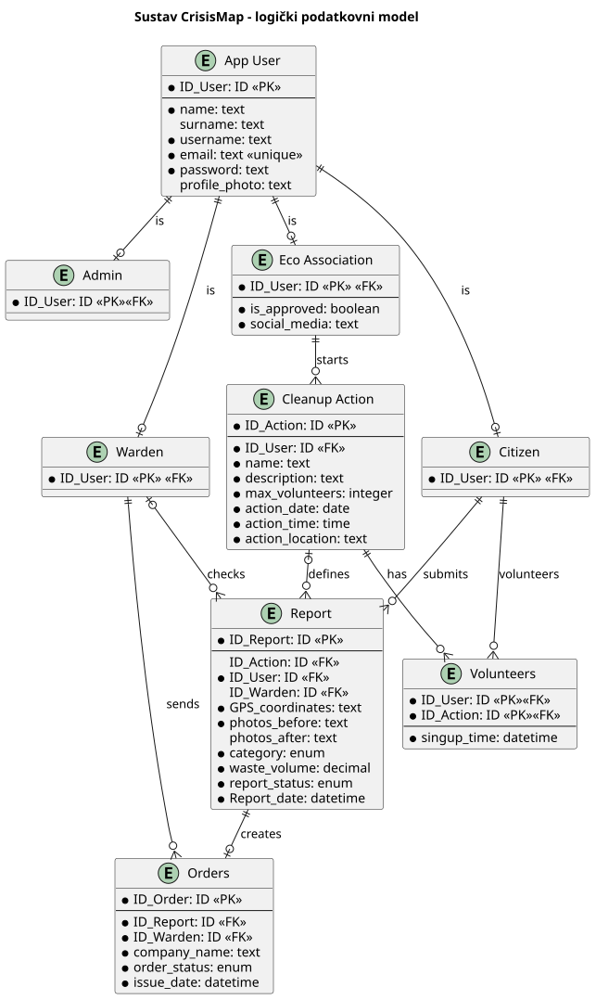
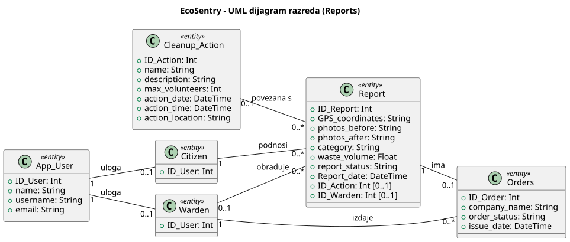

# 4. Arhitektura i oblikovanje

## 4.1 Strategija rješenja

| Odluka | Razmatrana alternativa | Projektno specifično obrazloženje i kompromis |
| --- | --- | --- |
| Pristup bazi podataka preko Prisme | Ručno pisani SQL upiti  | Prisma omogućuje povezivanje backend dijela aplikacije s bazom preko definiranih modela. TypeScript tipovi automatski se generiraju te se time smanjuje mogućnost pogreške. Uz to Prisma olakšava ažuriranje baze podataka bez potrebe za ručnim mijenjanjem SQL koda. Loša strana: nakon svake promjene sheme članovi tima moraju ponovo generirati Prisma kod |
|Izrada frontenda pomoću Reacta| Izrada frontenda HTML-om, CSS-om i JavaScriptom |React je biblioteka koja se koristi za izradu korisničkih sučelja web-stranica i aplikacija. Njegova najveća prednost je komponentna struktura koja olakšava organizaciju koda, ponovno korištenje elemenata i održavanje aplikacije. Uz veliku zajednicu i bogat ekosustav biblioteka, React je fleksibilan, pouzdan i odličan za razvoj skalabilnih aplikacija. Loša strana: neki studenti nisu se susreli s Reactom pa to zahtijeva dodatno učenje|
|Korištenje TypeScripta|Korištenje JavaScripta|TypeScript je napredniji i bolje strukturiran od JavaScripta jer ima ono što JavaScriptu nedostaje. Kod njega možemo vidjeti greške tijekom pisanja koda te nam je tako lakše i raditi. Loša strana: neki studenti nisu se susreli s TypeScriptom pa to zahtijeva dodatno učenje|
|Rad u zasebnim granama (branchevima) i spajanje u main preko pull requesta|Svi rade na jednoj grani|Više ljudi istovremeno mijenja backend,frontend i dokumentaciju,pa zasebne grane omogućuju da svatko radi svoj dio bez miješanja s drugim osobama, a kasnije se to sve spoji u main. Loša strana: ako je dogovor loš između sudionika tima pa dvoje ljudi mijenja isti dio datoteke te tako nastaje sukob koji se onda mora ručno rješavati|
|Backend podijeljen na module po funkcionalnosti|Sav kod na jednom mjestu|Svaka cjelina ima svoju mapu, pa se backend tim može lakše raspodijeliti po zadacima. Uz to sve je preglednije i brže se nalazi određen dio koda koji se želi urediti ili napraviti. Loša strana: ponekad se neka funkcionalnost programira u više mapa, što je teže i dulje nego kad je sve na istom mjestu |

## 4.2 Gradivni blokovi i UML dijagram komponenata

| Dio | Odgovornost | Razlog za ovu granicu |
| --- | --- | --- |
|Web Klijent (fronted)|Prikazuje interaktivnu kartu, omogućuje unos novih prijava te pregled akcija|Odvajanje korisničkog sučelja od obrade podataka i pohrane|
|Prisma Client|Služi kao prevoditelj (ORM sloj) između programskog koda u TypeScriptu i baze podataka|Omogućuje da moduli ne moraju pisati SQL upite za bazu, već da rade s podacima na isti način preko jednog zajedničkog mjesta|
|Modul za autentifikaciju (src/auth)|Provjerava identitet korisnika prilikom prijave i upravlja korisničkim ulogama|Provjera lozinki i prava pristupa su smještena na jednom mjestu, odvojena od ostatka sustava|
|Modul za prijave odlagališta (src/reports)|Obrađivanje zaprimljenih prijava otpada, provjera valjanosti te promjena statusa lokacije|Sve prijave i pravila njihove obrade nalaze se na jednom mjestu|
|Modul za akcije (src/actions)|Omogućuje udrugama kreiranje akcija čišćenja. Pomaže u određivanju datuma i lokacija akcija te dodavanju određenog broja volontera u akciju|Omogućuje bolju organizaciju akcija čišćenja koje mogu obuhvatiti više prijava te sprječavanje mogućih preklapanja|
|Model za volontere (src/volunteers)|Omogućuje prijavu građana na akcije čišćenja ako akcija nije popunjena i ako građanin već nije prijavljen na drugu akciju u isto vrijeme|Lakša organizacija oko raspodjele građana na akcije čišćenja|
|Modul za službene naloge (src/orders)|Omogućuje komunalnim redarima generiranje naloga komunalnim tvrtkama za teški i opasni otpad|Odvaja službene postupke od volonterskih akcija|

## 4.3 Podaci i detaljno oblikovanje

### 4.3.1 ER dijagram i model podataka
 
**Implementacija:** Pristup bazi podataka implementiran je pomoću Prisme. Model podataka definiran je u [Prisma shemi](../backend/prisma/schema.prisma).

**Primjer — CrisisMap:** Petar se prijavljuje u sustav unoseći podatke navedene u App User. Kada primijeti zagađenu lokaciju on odlučuje slati prijavu 'R-22' te lokacije kako bi se ona očistila. Redar provjerava ovu prijavu te gleda hoće li poslati nalog komunalnoj tvrtki. Ako do toga ne dođe Ekoudruga pokreće akciju čišćenja te se Petar i sam može u nju uključiti ako ima slobodnih mjesta.

**Slika 4.2. ER dijagram podataka sustava CrisisMap**

**PlantUML izvor:** [izvor](./puml/4-2-crisismap-data-ERD.puml)

### 4.3.2 Reprezentativni UML dijagram razreda

**Referenca na kod pri završnom pregledu:** [Poveznica na odgovarajuću implementaciju.](../backend)

**Primjer — CrisisMap:** Građanin kojeg korisnik aplikacije stvara novu prijavu koju obrađuje komunalni redar koji može poslati nalog za čišćenje lokacije iz prijave ili prijavu ostaviti (eko udruzi koja još nije definirana) koja na osnovu prijave otvara novu akciju čišćenja. Dijagram predlaže te odgovornosti prije implementacije.

**Slika 4.3. Dijagram razreda za obradu prijava kriznih događaja**

**PlantUML izvor:** [izvor](./puml/4-3-crisismap-domain-CD.puml)

## 4.4 Ponašanje tijekom izvođenja

**Cilj:** Objasniti jednu važnu interakciju među dijelovima koji se izvode i životni ciklus jednog smislenog objekta. Odaberite primjere koji otkrivaju odluke ili neuspješne putove umjesto izrade dijagrama za svaku CRUD radnju.

### 4.4.1 Reprezentativni UML sekvencijski dijagram

**Cilj:** Prikazati redoslijed poruka za jedan reprezentativni scenarij i odgovore na važnu alternativu.

**Scenarij:** [Naziv interakcije; dodajte UC ID ako postoji.]  
**sekvencijski dijagram:** [Ugradite čitljiv UML sekvencijski dijagram.]  
**PlantUML izvor:** [Poveznica na odgovarajuću `.puml` datoteku.]

<strong>Odabir lokacije, provjera valjanosti i podnošenje prijave</strong>

**Primjer — CrisisMap:** Građanin podnosi prijavu kriznog događaja nakon što ručno odabere lokaciju ili zatraži položaj uređaja. Interakcija prikazuje i što se događa kada je pristup lokaciji odbijen, podaci prijave nisu valjani ili pohrana ne uspije.

**Slika 4.4. Sekvencijski dijagram podnošenja prijave kriznog događaja**

**PlantUML izvor:** [izvor](./puml/4-4-crisismap-report-submission-SD.puml)

**Analiza primjera:** Dva načina odabira lokacije te alternative provjere i pohrane imaju različite posljedice za korisnika; usporedite ih s odgovarajućim obrascem uporabe i njegovim alternativnim tijekovima. API preglednika za lokaciju mogućnost je preglednika; web-klijent, API, usluga i pohrana odgovaraju prikazu komponenata. Odaberite grane koje pomažu objasniti scenarij vašeg projekta i završni dijagram uskladite s implementiranom interakcijom.

### 4.4.2 Reprezentativni UML dijagram stanja

**Cilj:** Prikazati važna stanja jednog domenskog objekta ili eksplicitno upravljanog načina rada sustava te događaje ili uvjete koji ih mijenjaju.

**Vlasnik stanja i razlog odabira:** [Navedite objekt ili način rada sustava, kako se njegovo stanje prepoznaje i zašto su prijelazi važni.]  
**Dijagram stanja:** [Ugradite čitljiv UML dijagram stanja.]  
**PlantUML izvor:** [Poveznica na odgovarajuću `.puml` datoteku.]

<strong>Načini rada i dostupnost usluge</strong>

**Primjer — CrisisMap:** Način koordinacije kriznog događaja mijenja se kako se događaj procjenjuje i rješava. Istodobno se korisniku vidljiva dostupnost aplikacije može neovisno mijenjati kada pružatelj karte ili poslužiteljski sustav postanu nedostupni.

**Slika 4.5. Dijagram stanja prijave kriznog događaja**

**PlantUML izvor:** [izvor](./puml/4-5-crisismap-report-SM.puml)

**Analiza primjera:** Dvije regije opisuju neovisne aspekte modeliranog sustava: način koordinacije kriznog događaja i opaženu dostupnost usluge. Izvode se paralelno; aktivni krizni događaj može postojati uz normalno ili ograničeno pružanje usluge. Grane nakon oporavka poslužiteljskog sustava uzimaju u obzir da pružatelj karte možda i dalje nije dostupan. Prijelazi stanja imaju imenovane okidače ili uvjete umjesto da budu samo popis zaslona. Ovaj oblik koristite samo ako aplikacija stvarno održava ili pouzdano izvodi obje vrste stanja. Projekt čiji važan životni ciklus pripada prijavi, rezervaciji ili narudžbi treba modelirati taj objekt; složenost dijagrama nije kriterij vrednovanja. Pri završnom pregledu model stanja usporedite s ponašanjem koje pokrenuta aplikacija stvarno podržava.

## 4.5 Zapisi arhitekturnih odluka

**Cilj:** Sačuvati razloge i obrazložiti odabrane važne arhitekturne odluke kada tablica u odjelku 4.1 nije dovoljna za očuvanje konteksta, razmatranih alternativa i prihvaćenih kompromisa.

Napišite nekoliko ADR-a samo za važne odluke čije obrazloženje, alternative i kompromis treba sačuvati. Ostale arhitekturne odluke dovoljno je zabilježiti u tablici.

**Detaljni zapis arhitekturne odluke (engl. Architecture Decision Record, ADR), kada odluka zahtijeva dodatno objašnjenje:**

### ADR-[ID]: [Naslov odluke]

| Polje | Zapis odluke |
| --- | --- |
| Kontekst i cilj | [Koji je arhitekturni problem učinio ovu odluku potrebnom?] |
| Kriteriji odluke | [Što je timu stvarno bilo važno?] |
| Razmatrane alternative | [Realne mogućnosti koje je tim razmotrio, ukratko.] |
| Odluka i obrazloženje | [Odabrana mogućnost, zašto je odabrana i čega se tim odrekao.] |
| Status | [Predloženo, prihvaćeno ili zamijenjeno; ako je primjenjivo, poveznica na novu odluku.] |

ADR pišite samo za odluku čije će obrazloženje ostati važno i nakon promjene implementacije. Značajna promjena odluke može se zabilježiti novim ADR-om koji zamjenjuje stari; rutinski odabiri alata ne trebaju detaljne zapise. Promjene dogovorenog opsega pripadaju zahtjevima i njihovoj povijesti promjena; povratna informacija o zadatku ostaje uz odgovarajući zadatak.

<strong>Odabir jednog poslužiteljskog sustava umjesto zasebno postavljenih usluga</strong>

**Primjer — CrisisMap, ADR-01:**

| ID | Datum | Odluka | Razmatrana alternativa | Obrazloženje i kompromis | Status |
| --- | --- | --- | --- | --- | --- |
| ADR-01 | [Datum odluke] | Jedan poslužiteljski API za obradu prijava | Zasebno postavljene usluge za prijave i resurse | Manji napor postavljanja i integracije za odobreni opseg; kvar poslužiteljskog sustava može utjecati na obje funkcionalnosti. | Prihvaćeno |

### ADR-01: Jedan poslužiteljski API za obradu prijava

| Polje | Zapis odluke |
| --- | --- |
| Kontekst i cilj | Tim tijekom jednog semestra mora izraditi i javno postaviti prijavljivanje kriznih događaja i prikaz usmjeren na kartu. |
| Kriteriji odluke | Tim može izraditi, integrirati, postaviti i objasniti rješenje; komponente i dalje imaju prepoznatljive odgovornosti. |
| Razmatrane alternative | **Jedan poslužiteljski sustav:** moduli dijele aplikaciju koja se postavlja kao cjelina. **Zasebne usluge:** svaka se može izvoditi neovisno, ali zahtijeva dodatni rad na integraciji i postavljanju. |
| Odluka i obrazloženje | Odabrati jedan poslužiteljski sustav s jasno odvojenim odgovornostima vezanim uz prijave. Time se smanjuje rad na postavljanju, uz prihvaćanje da kvar tog sustava može istodobno utjecati na rad s prijavama. |
| Status | Prihvaćeno. |

**Analiza primjera:** Strategija rješenja navodi trenutačni pristup; ADR-01 čuva alternative i kriterije koji su do njega doveli. Dijagrami komponenata i razmještaja trebaju odražavati odabrani pristup kako se sustav razvija. Zaseban ADR koristan je za važnu odluku, a ne za svaki odabir alata.

## 4.6 Koncepti koji prožimaju sustav

**Cilj:** Prepoznati važan mehanizam ili pravilo oblikovanja koje se primjenjuje u više dijelova aplikacije, opisati gdje se planira primijeniti i ažurirati objašnjenje kako implementacija poprima konačan oblik. Uključite samo koncepte koji su važni za ovaj projekt.

| Aspekt | Mehanizam i mjesto primjene | Dokaz u završnoj implementaciji |
| --- | --- | --- |
|  |  |  |

<strong>Opis zajedničkog pravila kroz njegovu implementaciju</strong>

**Primjer — CrisisMap:**

| Aspekt | Mehanizam i mjesto primjene | Referenca na kod ili konfiguraciju |
| --- | --- | --- |
| Pravilo sustava: autorizacija moderiranja prijava | Poslužiteljski sustav provjerava ovlasti moderatora prije odobravanja ili odbijanja prijave; gumb za prijavu u klijentu nije dovoljna zaštita. | Pri završnom pregledu pokažite provjeru ovlasti u poslužiteljskom sustavu i ispitivanje neovlaštenog pristupa. |
| Zajedničko implementacijsko pravilo: provjera lokacije | Granica podnošenja prijave odbija nedostajuće ili nevaljane koordinate prije pohrane prijave. | Pri završnom pregledu pokažite pravilo provjere i ispitivanje s nevaljanim koordinatama. |

**Analiza primjera:** Prvi redak opisuje zaštitu preko granice sustava; drugi pravilo zajedničko različitim putovima podnošenja prijave. Odaberite aspekte koji stvarno utječu na vaš projekt.

Obrasci poput Dependency Injection ili Repository pripadaju ovdje samo kada ih kod stvarno koristi i kada objašnjavaju zajedničko pravilo oblikovanja. Tvrdnja „sustav koristi autentikaciju” sama po sebi ne govori čitatelju gdje se provjera provodi niti što štiti. Sigurnost, bilježenje događaja i obrada pogrešaka ne trebaju svaki zaseban pododjeljak po zadanom pravilu.

## 4.7 Arhitekturni rizici i tehnički dug

**Cilj:** Navesti stvarne tehničke ili domenske rizike i svjesno prihvaćene kompromise oblikovanja, njihove posljedice i način na koji ih tim obrađuje.

**Tehnički rizici i dug**

| Rizik ili kompromis | Posljedica | Trenutačni pristup |
| --- | --- | --- |
|  |  |  |

**Poslovni ili domenski rizici, ako su značajni**

| Rizik | Posljedica | Trenutačni pristup |
| --- | --- | --- |
|  |  |  |

<strong>Prepoznavanje ograničenja bez izmišljanja produkcijske infrastrukture</strong>

**Primjer — CrisisMap, tehnički rizici:**

| Rizik ili kompromis | Posljedica | Trenutačni pristup |
| --- | --- | --- |
| Jedna instanca aplikacije obrađuje podnošenje prijava. | Kvar smještaja aplikacije privremeno onemogućuje nove prijave. | Prihvaćeno u okviru projekta kolegija; tim ne tvrdi da postoji automatsko prebacivanje na pričuvni sustav. |
| Vanjske kartografske pločice nisu dostupne. | Prikaz karte može prestati raditi iako su pohranjene prijave i dalje dostupne. | Objasnite korisniku vidljivu pogrešku ili alternativu koju implementirana aplikacija stvarno pruža. |

**Primjer — CrisisMap, domenski rizik:** Čitatelji mogu neprovjerenu prijavu građanina zamijeniti za službeno upozorenje. Tim može u sučelju jasno razlikovati status provjere prijave i uputiti korisnike na službene izvore.

**Analiza primjera:** Prvi tehnički rizik prihvaća realistično ograničenje projekta kolegija; domenski se rizik odnosi na način na koji čitatelj tumači prijavu. Zabilježite ograničenje i realan odgovor koji pripadaju vašem projektu. Neostvarena obavezna funkcionalnost nije tehnički dug nego nedovršen opseg.

**Završna provjera:** Usporedite dijagrame komponenata, podataka, razreda, sekvencijski dijagram i dijagram stanja s implementiranim kodom, ponašanjem aplikacije i stvarnim razmještajem. Ažurirajte zastarjele opise oblikovanja i objasnite svaku važnu razliku koja ostaje; poveznice na odgovarajući kod ili ispitivanja korisne su kada odgovaraju na konkretno pitanje.
